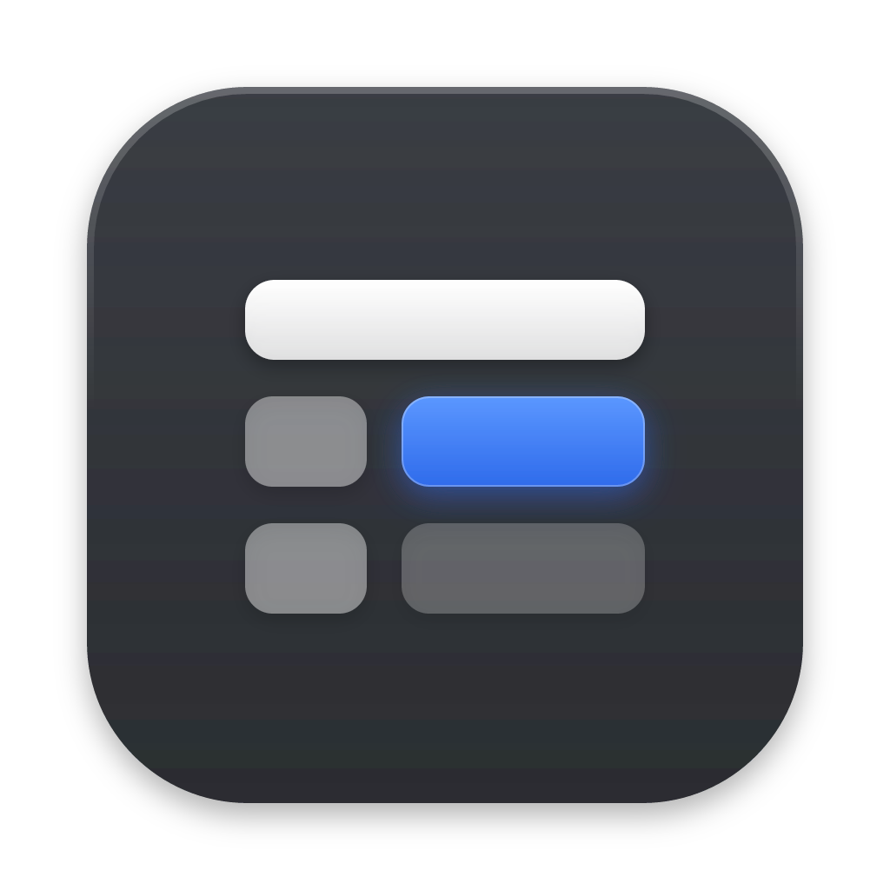

<p align="center"></p>

# Slate

A quiet, fast PostgreSQL studio for the Mac: browse, filter, edit and query your data.

- **Browse** any table in a fast grid that stays smooth on big tables. Sort by several columns, follow a foreign key in one click, and open any row in a side panel.
- **Filter** with stacked conditions that know each column's type, enum pickers, a raw `WHERE`, or full-row search. Right-click a cell to filter by it.
- **Edit** in place. Changes are staged and shown as SQL before anything is written, then saved in one transaction. If an update would touch anything other than exactly one row, the whole batch is rolled back.
- **Query** in an editor that knows your schema: autocomplete for tables, columns and aliases, ⌘↵ to run the statement under the cursor, several result sets, `EXPLAIN`, and transactions that stay open across runs.
- **Structure**: columns, indexes, constraints, foreign keys, triggers and DDL. Add, rename, retype or drop columns and indexes, each shown as SQL first.
- **Activity**: see what's running on the server and cancel or end it.
- ⌘K jumps to any table, query or action. Light and dark themes.

## Install

1. Download **Slate.dmg** from the [latest release](../../releases/latest), open it and drag **Slate** onto the Applications folder. On an Intel Mac, download **Slate-Intel.dmg** instead.
2. Open Slate from Applications. macOS will say it can't check the app, because Slate isn't notarised by Apple (that needs a paid Apple developer account). Click **Done**.
3. Open **System Settings → Privacy & Security**, scroll down to the message about Slate, click **Open Anyway** and confirm. You only do this once.
4. Click **New connection**, or paste a `postgres://` URL anywhere on the home screen.

If you're comfortable in Terminal, this does steps 2 and 3 in one go:

```bash
xattr -dr com.apple.quarantine /Applications/Slate.app
```

**Needs:** macOS 11 or later. Built and tested on macOS 27.2 on Apple silicon. The Intel build is included but untested.

## Build it yourself

You need Node 22 or later and pnpm.

```bash
pnpm install
```

Build and open the desktop app:

```bash
pnpm app
```

`./scripts/package.sh` builds the app and packages it for sharing as a disk image and a zip, for Apple silicon and Intel, in `release/`. `pnpm icons` redraws the icon from `build/icon.svg`.

For development, `pnpm dev` runs the API on port 4317 and the UI with hot reload on port 5317. `pnpm build && pnpm start` runs Slate as a local web app at http://127.0.0.1:4317.

Checks:

```bash
pnpm typecheck
```

```bash
SLATE_NO_LISTEN=1 pnpm test
```

To try it on made-up data, load `scripts/demo.sql` into a throwaway database.

## How it works

- `server/` is a small [Hono](https://hono.dev) API over [node-postgres](https://node-postgres.com): connections, reading the schema, rows and edits, query sessions and export. In the desktop app it runs inside the app itself.
- `src/` is the React UI: the grid (virtualised with TanStack Virtual), filters, the [CodeMirror](https://codemirror.net) editor, structure, activity and the command palette.
- `electron/` is the desktop shell. esbuild bundles the server and the shell into one file.
- `shared/` holds types and SQL helpers used by both sides, and `tests/` the unit tests.

Each query tab has its own database session, which is why `BEGIN … COMMIT` works across runs. Browsing a table always happens in a read-only transaction.

## Security

- The server only listens on `127.0.0.1`.
- Every request must come from a loopback `Host` and `Origin`, which stops DNS rebinding, and carry an `x-slate-client` header, which stops simple cross-site requests.
- In the desktop app, every request also needs a random token made fresh at each launch. The page gets it through a sandboxed preload and has no Node access. The server uses port 47317 so the page keeps its saved tabs between launches, and falls back to a random port if that one is taken.
- Set `SLATE_TOKEN` to require a token in web mode too.
- Connections, saved queries and history are kept in `~/.slate` (or `SLATE_HOME`), written with owner-only permissions. Passwords are stored there in plain text, protected by those permissions, and are never sent back to the UI.
- Read-only connections set `default_transaction_read_only` for every session.

## Good to know

- `~/Library/Logs/Slate/main.log` records crashes and errors, so you can see what happened after the fact.
- Slate isn't notarised, so each new version needs the **Open Anyway** step once.
